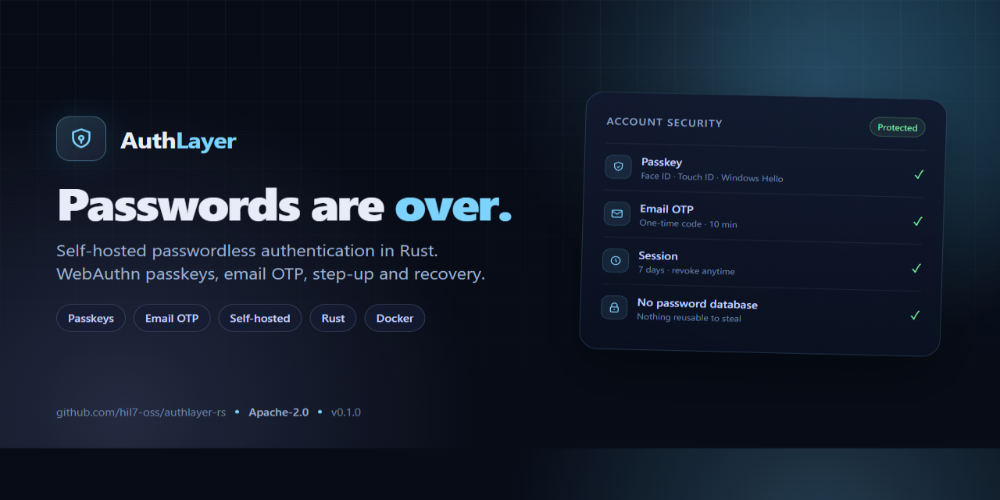
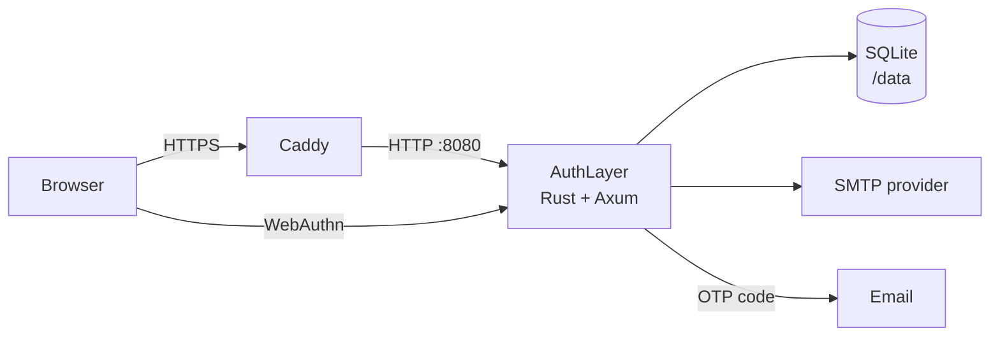

# AuthLayer

**Self-hosted passwordless authentication in Rust. Passkeys + email OTP. No passwords.**

[](https://github.com/hil7-oss/authlayer-rs/actions/workflows/ci.yml)
[](LICENSE)
[](https://www.rust-lang.org/)
[](authlayer/SECURITY_REVIEW_ROUND3.md)

AuthLayer is an open-source authentication server that replaces passwords with **WebAuthn passkeys** and **one-time email codes**. It ships as a single Rust binary with SQLite, a browser UI, SMTP delivery, recovery codes, step-up verification, and Docker deployment.



> **Status:** `v0.1.0` is a **conditional self-hosted release**, not a public SaaS or a drop-in replacement for every legacy app. Read [Security](#security) before exposing it to the internet.

---

## Why AuthLayer

- **No password database.** There is no password column, no hash to crack, and no "forgot password" flow.
- **Phishing-resistant login.** Passkeys are bound to the origin and the private key stays in the device's TPM / Secure Enclave / Keystore.
- **Email is only a bootstrap.** A one-time code gets the user started; sensitive actions require a fresh passkey confirmation.
- **Self-hosted by default.** SQLite, one binary, Docker Compose, Caddy, systemd. No vendor account required.
- **Recovery is designed in.** Eight one-time recovery codes, expiry, and old-credential revocation.
- **Operational controls.** Step-up, session revocation, sign-out-everywhere, admin sessions, audit events, rate limits.

## Features

| Area | What is implemented |
|---|---|
| **Sign-up / sign-in** | Email OTP (6 digits, 10 min, one-time, max 5 attempts) |
| **Passkeys** | WebAuthn registration, login, add another passkey |
| **Sessions** | 7-day absolute, 24-hour idle, `HttpOnly`, `SameSite=Strict`, `__Host-`, passkey binding |
| **Step-up** | Fresh passkey confirmation for add-passkey, recovery regeneration, passkey revoke, revoke-all |
| **Recovery** | 8 context-bound codes, 365-day TTL, atomic use, old sessions/passkeys revoked |
| **Admin** | `/admin/login`, DB-backed admin sessions, 1-hour TTL, rate limit, audit |
| **Email** | SMTP via `lettre`, TLS required in production, dev outbox for local testing |
| **Deployment** | Dockerfile, Compose + Caddy, systemd, `.env.example` |
| **Hardening** | Origin enforcement, trusted-proxy CIDRs, no-store, WAL, cleanup, conflict-safe challenges |
| **UI** | Responsive browser UI: email, passkeys, recovery, dashboard, sessions, sign-out-everywhere |

## Architecture



The app is a single process. SQLite, in-memory WebAuthn challenges, and the rate limiter make v0.1 a **single-instance** deployment. Postgres/Redis and multi-instance support are planned for v0.2.

## Quick start (local development)

Prerequisites: Rust 1.100+ and a shell. `localhost` is treated as a secure context by browsers, so WebAuthn works over HTTP locally.

```powershell
git clone https://github.com/hil7-oss/authlayer-rs.git
cd authlayer-rs/authlayer

$env:APP_URL="http://localhost:8080"
$env:RP_ID="localhost"
$env:BIND_ADDR="127.0.0.1:8080"
$env:DATABASE_URL="sqlite://authlayer.db?mode=rwc"
$env:DEV_MODE="true"
$env:EMAIL_PROVIDER="outbox"
$env:OTP_SECRET="dev-only-secret-0123456789abcdef0123456789"
$env:COOKIE_SECURE="false"
$env:COOKIE_NAME="al_session"

cargo run
```

Open `http://localhost:8080`. In dev/outbox mode, the email code is available at `http://localhost:8080/dev/outbox`.

> Never use `DEV_MODE=true` or `EMAIL_PROVIDER=outbox` in production. The app refuses to start in unsafe combinations unless explicit `ALLOW_*` escape hatches are set.

## Production deployment (Docker + Caddy)

```bash
git clone https://github.com/hil7-oss/authlayer-rs.git
cd authlayer-rs/authlayer

cp .env.example .env
# Edit .env: real domain, APP_URL, RP_ID, OTP_SECRET, SMTP_*, ADMIN_TOKEN
# APP_URL must be https://...; RP_ID must equal the APP_URL host.
# Generate OTP_SECRET: openssl rand -hex 32

docker compose up -d --build
```

The provided Compose file:

- exposes only Caddy (80/443), not the app port;
- runs the app as non-root with a read-only root filesystem, `/data` volume, `cap_drop: ALL`, and resource limits;
- uses a dedicated `172.28.0.0/16` network and trusted-proxy CIDRs;
- fails closed if SMTP, `OTP_SECRET`, or secure cookies are misconfigured.

Full deployment details: [`authlayer/deploy/README.md`](authlayer/deploy/README.md).

## Security

The project has been through three internal reviews. The current verdict is in [`authlayer/SECURITY_REVIEW_ROUND3.md`](authlayer/SECURITY_REVIEW_ROUND3.md).

**Conditional GO** only for a **fresh, single-instance** deployment behind the provided Caddy, with:

- `DEV_MODE=false`, HTTPS, `COOKIE_SECURE=true`, `__Host-al_session`;
- `EMAIL_PROVIDER=smtp` and `SMTP_TLS=required`;
- exact `RP_ID` matching `APP_URL` host;
- strong random `OTP_SECRET` and `ADMIN_TOKEN`;
- admin disabled or restricted at the network layer;
- migration `0003` applied with a backup;
- edge CAPTCHA / rate limits if signup is open to the public.

**Not approved for:**

- unrestricted public signup without CAPTCHA/abuse controls;
- high-value or real-money accounts without an external audit;
- upgrades from a pre-hardening database without migration and counter backfill;
- sharing the app port directly or running it without TLS.

### Security model in one screen

- Passwordless by construction: no password storage, no password reset.
- OTPs are HMAC-bound to user, purpose, OTP id, and expiry; wrong attempts are limited.
- Passkey assertions require user verification; counter regressions are rejected for device-bound credentials.
- Sessions are 256-bit opaque tokens, stored as SHA-256 hashes, bound to a passkey, revocable individually or all at once.
- Recovery codes are context-bound, expiring, one-time; successful recovery revokes old sessions/passkeys.
- Admin uses DB-backed sessions and a separate `al_admin` cookie; logout revokes the DB row.
- Production state-changing requests require `Origin`; WebAuthn ceremonies are bound to an `al_ceremony` cookie.

## Verified

| Check | Result |
|---|---|
| `cargo fmt` / `check` / `clippy -D warnings` / `test` / `build` | pass |
| HTTP smoke (`scripts/smoke.mjs`) | **26/26** |
| Browser E2E (Chrome + CDP virtual authenticator) | **18/18** |
| Docker read-only + limits | **healthy**, `/healthz` 200 |
| SMTP delivery via local Mailpit | **PASS** (OTP email → code → verify) |
| Production Origin policy | missing/foreign `Origin` → 403; exact → 200 |

## Documentation

- [`authlayer/README.md`](authlayer/README.md) — Russian quickstart, env contract, API, limitations.
- [`authlayer/docs/IMPLEMENTATION.md`](authlayer/docs/IMPLEMENTATION.md) — architecture, flows, data model, security trade-offs.
- [`PROJECT_STATE.md`](PROJECT_STATE.md) — exact current state, verified results, remaining risks.
- [`CHANGELOG.md`](CHANGELOG.md) — v0.1.0 scope.
- [`authlayer/SECURITY_REVIEW_ROUND3.md`](authlayer/SECURITY_REVIEW_ROUND3.md) — current security verdict.
- [`SECURITY.md`](SECURITY.md) — vulnerability disclosure policy.

## Status and limitations

v0.1.0 is a **working, tested foundation**, not a finished global standard.

Known gaps:

- external SMTP provider not live-tested (local Mailpit passes);
- real devices (Windows Hello, Touch ID, Android, iOS, YubiKey) not in CI;
- no independent external audit;
- sessions are still bearer tokens without DPoP/DBSC;
- no CAPTCHA/global abuse budget for open signup;
- recovery has no delay/second-channel step-up;
- upgrade path needs counter backfill or passkey re-registration;
- rotating `ADMIN_TOKEN` does not revoke existing admin sessions;
- single-instance SQLite only.

Planned for v0.2: Postgres, DPoP/DBSC, CAPTCHA/abuse controls, recovery delay, admin token rotation revocation, counter backfill, real-device matrix, external audit.

## Contributing

Issues and pull requests are welcome. Please read [`SECURITY.md`](SECURITY.md) before reporting a vulnerability. For changes, run:

```bash
cd authlayer
cargo fmt --check
cargo clippy --all-targets -- -D warnings
cargo test
```

## License

Apache-2.0. See [`LICENSE`](LICENSE).
