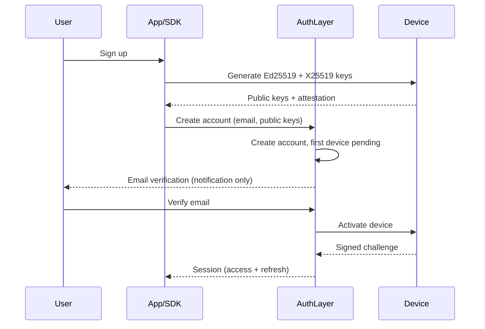
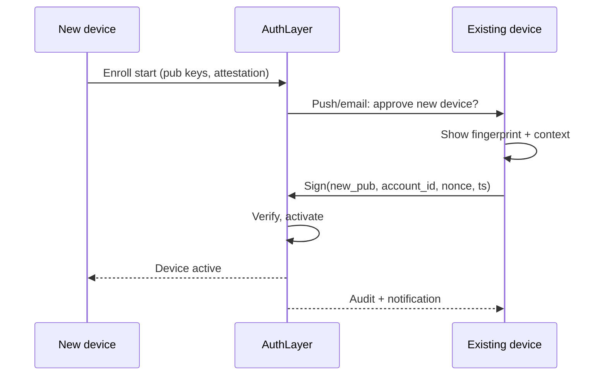
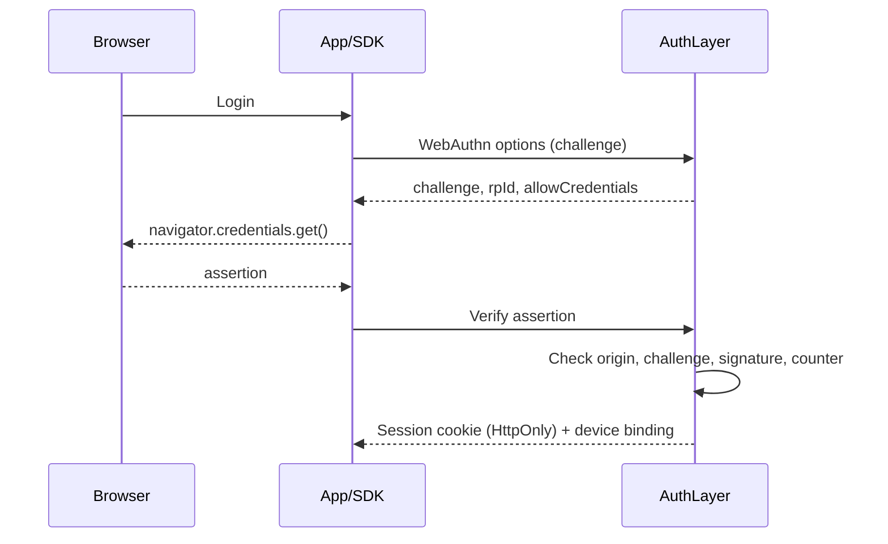
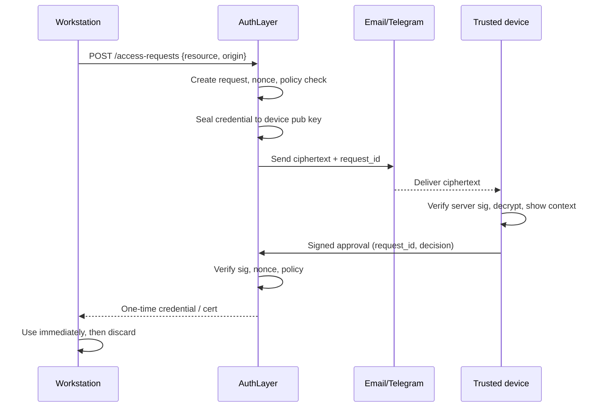
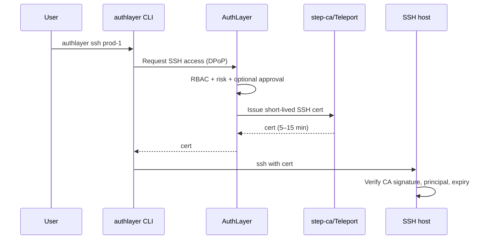

# AuthLayer — архитектура

> **Статус документа:** это целевая архитектура и видение, а не описание текущего кода. Рабочая реализация v0.1 находится в `authlayer/`; её фактические API, схема БД и ограничения описаны в `PROJECT_STATE.md` и `authlayer/docs/IMPLEMENTATION.md`. Части про `/v1`, Postgres/Redis, DPoP/DBSC, sealed delivery, SSH и legacy-брокер — это roadmap, а не текущие функции.

Рабочее название проекта — **AuthLayer**. Это не «ещё один менеджер паролей» и не замена OAuth. Это слой, который убирает ручной ввод паролей и делает украденные секреты бесполезными вне доверенного устройства.

---

## Содержание

1. [Резюме](#1-резюме)
2. [Требования и не-цели](#2-требования-и-не-цели)
3. [Криптографическая модель: что возможно, а что нет](#3-криптографическая-модель-что-возможно-а-что-нет)
4. [Акторы и границы доверия](#4-акторы-и-границы-доверия)
5. [Архитектура библиотеки и шлюза](#5-архитектура-библиотеки-и-шлюза)
6. [Сессии и куки](#6-сессии-и-куки)
7. [Потоки](#7-потоки)
8. [Криптографическая спецификация](#8-криптографическая-спецификация)
9. [Модель данных](#9-модель-данных)
10. [API](#10-api)
11. [Политики и риск](#11-политики-и-риск)
12. [Модель угроз](#12-модель-угроз)
13. [Деплой на Ubuntu](#13-деплой-на-ubuntu)
14. [Что не строить](#14-что-не-строить)
15. [Открытые вопросы](#15-открытые-вопросы)

---

## 1. Резюме

### 1.1. Идея в одном абзаце

Пользователь не вводит пароль. У каждого доверенного устройства есть аппаратно защищённая пара ключей. Сервер знает только публичные ключи. Когда нужно получить доступ к ресурсу, сервер создаёт одноразовый секрет, шифрует его на публичный ключ устройства и отправляет по любому каналу — email, Telegram, push. Канал видит только шифротекст. Устройство расшифровывает, показывает контекст запроса, пользователь подтверждает биометрией, устройство подписывает подтверждение. Сервер проверяет подпись, устройство и политику — и только тогда выдаёт доступ: passkey-сессию, короткоживущий SSH-сертификат или одноразовый пароль для legacy-сайта.

### 1.2. Что именно продаётся/строится

Не «криптография», а **оркестрация доступа**:

- единая идентичность на публичных ключах;
- устройство как ключ;
- одноразовые секреты вместо постоянных паролей;
- короткоживущие сертификаты вместо SSH-ключей;
- брокер для legacy-приложений;
- аудит и отзыв;
- библиотека/шлюз, который встраивается в приложения.

### 1.3. Три продукта в одном

| Продукт | Пользователь | Что получает |
|---|---|---|
| **AuthLayer SDK** | разработчик своего приложения | passkeys, сессии, устройства, API |
| **AuthLayer Gateway** | админ сервера | SSO/forward-auth для любых приложений за Caddy/Nginx |
| **AuthLayer Agent** | разработчик/админ | SSH без паролей, автозаполнение legacy-сайтов |

Их можно продавать/использовать вместе или по отдельности.

---

## 2. Требования и не-цели

### 2.1. Функциональные требования

| ID | Требование |
|---|---|
| R1 | Регистрация и вход без ручного ввода пароля |
| R2 | Доверенное устройство хранит приватный ключ в TPM/Secure Enclave/Keystore |
| R3 | Секрет доставляется по email/мессенджеру только в зашифрованном виде |
| R4 | Компрометация email/мессенджера не даёт доступа к аккаунту |
| R5 | Добавление нового устройства требует подтверждения существующего |
| R6 | Сессия: access 10–15 мин, refresh 7 дней, абсолютный срок 7 дней |
| R7 | Отзыв устройства инвалидирует все его сессии |
| R8 | SSH-доступ через короткоживущие сертификаты |
| R9 | Legacy web: автозаполнение одноразового пароля через расширение |
| R10 | Аудит всех выдач и подтверждений |
| R11 | Библиотека для Node/Python/Go + gateway для любых приложений |
| R12 | Установка на Ubuntu: Docker, .deb, systemd |

### 2.2. Не-цели

| Не делаем | Почему |
|---|---|
| Не заменяем OAuth/OIDC | Используем как стандарт, не изобретаем |
| Не пишем свою WebAuthn-библиотеку | Есть SimpleWebAuthn, go-webauthn, py_webauthn |
| Не пишем свой CA | Есть step-ca/Teleport |
| Не пишем свою криптографию | Есть libsodium, HPKE, JOSE |
| Не обещаем passwordless для чужих сайтов | Там пароль существует; можем только брокерить |
| Не защищаем от malware на рабочей станции | Это вне модели; можно снизить риск |
| Не обходим MFA/CAPTCHA третьих сторон | Это нелегитимно и технически хрупко |
| Не храним plaintext-пароли без крайней необходимости | Legacy-брокер — исключение, с шифрованием и аудитом |

### 2.3. Ключевой принцип разделения

> **Приватный ключ — на устройстве. Политика и аудит — на сервере. Секрет — нигде в открытом виде.**

Если «вся логика на сервере» понимать буквально, сервер сможет выдать себя за пользователя. Если весь ключ на клиенте, клиент нельзя централизованно отозвать. Нужен баланс:

- устройство хранит ключ и подписывает;
- сервер хранит политику, сессии, аудит, шифротексты;
- секрет расшифровывается только устройством;
- сервер может отозвать устройство, но не может подписать за него.

---

## 3. Криптографическая модель: что возможно, а что нет

### 3.1. Почему «хеш → разхеш» невозможно

Хеш-функция `H(x)` необратима. Из `H(password)` нельзя получить `password` за разумное время. Если приложение умеет «разхешировать», оно хранит либо сам пароль, либо обратимый шифротекст, либо слабый хеш, который подбирается. В любом случае это не свойство безопасности, а иллюзия.

**Не делать:**

- `sha256(password)` как «защищённый пароль»;
- отправку хеша вместо пароля (хеш становится паролем);
- «шифрование» с ключом, который лежит рядом с шифротекстом;
- самодельные схемы «hash + salt + XOR».

### 3.2. Что использовать вместо

| Задача | Примитив | Где готовое |
|---|---|---|
| Доказать владение ключом | ЭЦП Ed25519 / ECDSA P-256 | `node:crypto`, libsodium, JOSE |
| Зашифровать секрет на устройство | HPKE (RFC 9180) или JWE `ECDH-ES` + `A256GCM` | `jose`, `@hpke/core`, libsodium sealed box |
| Вход без пароля в браузере | WebAuthn/passkeys | SimpleWebAuthn, go-webauthn |
| Привязать токен к устройству | DPoP (RFC 9449) | `jose`, oauth4webapi |
| Привязать куку к устройству | DBSC (Chrome 146+) | серверные endpoint'ы DBSC; fallback DPoP |
| Пароль, который не отправляется на сервер | OPAQUE (RFC 9807), если очень нужно | opaque-ke и аналоги |
| SSH без пароля | OpenSSH-сертификаты | step-ca, Teleport |
| Одноразовые секреты | Vault/OpenBao dynamic secrets | Vault, Infisical |

### 3.3. «Пароль зашифрован и бесполезен без устройства» — как это выглядит

```text
Сервер:
  payload = {credential, resource, origin, expires_at, request_id}
  ephemeral = X25519.generate()
  shared    = X25519(ephemeral.sk, device.pub_kem)
  key       = HKDF-SHA256(shared, salt, info="sealed-v1" || request_id)
  ct        = AES-256-GCM(key, nonce, payload, aad)
  sealed    = {ephemeral.pub, salt, nonce, ct, server_signature}

Email/Telegram:
  sealed (только шифротекст)

Устройство:
  shared = X25519(device.sk_kem, ephemeral.pub)
  key    = HKDF-SHA256(shared, salt, info=...)
  payload = AES-256-GCM.open(ct, key, nonce, aad)
  проверить server_signature
  показать контекст
  подписать approval устройством
```

Ничего не «разхешируется». Секрет **расшифровывается** ключом, который есть только у устройства.

### 3.4. Про «зашифровать куки и выдавать ключ после проверки»

Это распространённая, но неверная модель. Подробно — в [SESSIONS-AND-COOKIES.md](SESSIONS-AND-COOKIES.md). Кратко:

- кука — bearer-токен; кто украл, тот может отправить;
- шифрование protects confidentiality, но не replay;
- если сервер выдаёт ключ клиенту после проверки, атакующий может пройти ту же проверку;
- если ключ хранится в браузере, XSS/malware может его украсть;
- правильный ответ — **proof of possession**: ключ не покидает устройство, каждый запрос подписывается (DPoP), браузерная сессия привязывается через DBSC.

### 3.5. Про «любое приложение»

| Тип | Можно ли встроить без кода | Как |
|---|---|---|
| Своё Node/Python/Go приложение | да, SDK | middleware/adapters |
| Любое приложение за Nginx/Caddy | да, gateway | forward-auth + headers |
| Приложение со своим логином | частично | SSO/header auth, иначе брокер + автозаполнение |
| Чужой сайт в интернете | нет | только расширение/автозаполнение; серверная библиотека не попадёт на чужой сервер |
| SSH | да | CLI/agent + CA |
| База данных | да | Vault dynamic secrets |

«Универсальность» означает универсальный **интерфейс интеграции**, а не универсальный обход чужой авторизации.

### 3.6. TOTP и Google Authenticator

TOTP (RFC 6238) — это второй фактор, а не passwordless-замена. Особенности:

- код 6–8 цифр, шаг 30 секунд;
- секрет (seed) постоянный и хранится и у клиента, и у сервера;
- если сервер скомпрометирован, можно генерировать коды;
- код можно перехватить и успеть использовать (phishing/relay);
- Google Authenticator синхронизируется через облако, то есть seed может оказаться на другом устройстве;
- TOTP не привязан к origin, в отличие от WebAuthn.

Где TOTP уместен:

- как дополнительный фактор для legacy-сайтов, которые его требуют;
- как fallback, если passkey недоступен;
- как временный мост при миграции.

Где не уместен:

- как единственная замена пароля;
- как «пароль, который сам генерируется» для новых систем;
- как доказательство владения устройством (seed можно скопировать).

В AuthLayer TOTP seed может храниться в `credentials` (зашифрованным в KMS) для legacy-сайтов, а брокер генерирует код автоматически. Это удобно, но это ещё один секрет; его нужно ротировать и защищать. Для своих систем правильный выбор — passkeys.

---

## 4. Акторы и границы доверия

### 4.1. Акторы

| Актор | Доверие | Что хранит |
|---|---|---|
| **Пользователь** | доверенный, но ошибается | биометрия/PIN |
| **Доверенное устройство** (телефон/ноутбук) | высокое, аппаратный keystore | приватные ключи |
| **Рабочая станция** (ПК, где открывается админка/SSH) | низкое/среднее | временный сертификат/пароль |
| **Control plane** (AuthLayer) | высокое, но не всесильное | публичные ключи, политики, аудит, шифротексты |
| **Канал доставки** (email/Telegram/push) | **не доверенный** | только шифротекст |
| **Целевой ресурс** (сайт/SSH/БД) | зависит | свой пароль/ключ/сертификат |
| **Админ** | привилегированный | доступ к политике, не к ключам устройства |

### 4.2. Границы доверия

```text
┌──────────────────────── Trusted device ────────────────────────┐
│ Secure Enclave / TPM / Android Keystore / WebCrypto nonextract.│
│  Ed25519 sign key   ·   X25519 decrypt key                     │
└───────────────┬────────────────────────────────────────────────┘
                │  signed approvals, decrypted secrets
                │
┌───────────────▼────────────────────────────────────────────────┐
│                     AuthLayer control plane                    │
│  accounts · devices · sessions · policy · broker · audit       │
└───────┬───────────────────────────────┬────────────────────────┘
        │ ciphertext only               │ headers/session
┌───────▼──────────┐          ┌─────────▼──────────┐
│ Email / Telegram │          │ SDK / Gateway      │
│ (untrusted)      │          │ (trusted boundary) │
└───────┬──────────┘          └─────────┬──────────┘
        │                               │
┌───────▼──────────┐          ┌─────────▼──────────┐
│ Workstation      │          │ Target app / SSH    │
│ (low trust)      │          │ (resource)          │
└──────────────────┘          └────────────────────┘
```

### 4.3. Инварианты безопасности

1. Приватный ключ устройства не покидает аппаратный keystore.
2. Сервер никогда не хранит plaintext-секрет дольше, чем нужно для выдачи.
3. Email/мессенджер не является фактором аутентификации.
4. Новое устройство не добавляется только по email.
5. Сброс пароля на целевом сайте не должен обходить слой (иначе email снова критичен).
6. Все выдачи — одноразовые, с TTL и аудитом.
7. Отзыв устройства эффективен в течение секунд, а не дней.

---

## 5. Архитектура библиотеки и шлюза

### 5.1. Четыре режима поставки

#### Режим A. Embedded SDK

Библиотека внутри приложения. Подходит для одного приложения, где есть контроль над кодом и БД.

```ts
import { AuthLayer } from '@authlayer/server';

const auth = new AuthLayer({
  database: { url: process.env.DATABASE_URL },
  redis: { url: process.env.REDIS_URL },
  issuer: 'https://auth.example.com',
  webauthn: {
    rpId: 'example.com',
    rpName: 'Example',
    origin: 'https://example.com',
  },
  session: {
    cookieName: '__Host-al_session',
    accessTtl: '10m',
    refreshTtl: '7d',
    absoluteTtl: '7d',
    binding: 'dpop', // 'dpop' | 'dbsc' | 'mtls' | 'none'
  },
  delivery: {
    email: { provider: 'ses', from: 'no-reply@example.com' },
    telegram: { botToken: process.env.TELEGRAM_BOT_TOKEN },
  },
});

app.use(auth.middleware());
app.get('/api/me', auth.requireUser(), (req, res) => {
  res.json(req.user);
});
```

#### Режим B. Gateway / forward-auth

Отдельный сервис `authlayerd` стоит перед приложением. Приложение не меняется, но должно доверять заголовкам и быть недоступно напрямую.

```text
Browser → Caddy/Nginx → authlayerd (forward-auth) → App
                         │
                         └─ X-AuthLayer-User, X-AuthLayer-DeviceId, ...
```

Caddy:

```caddyfile
example.com {
    authlayer {
        upstream authlayerd:8080
    }
    reverse_proxy app:3000
}
```

Nginx:

```nginx
location / {
    auth_request /_authlayer;
    auth_request_set $al_user $upstream_http_x_authlayer_user;
    proxy_set_header X-AuthLayer-User $al_user;
    proxy_pass http://app:3000;
}

location = /_authlayer {
    internal;
    proxy_pass http://authlayerd:8080/verify;
    proxy_pass_request_body off;
    proxy_set_header Content-Length "";
    proxy_set_header X-Original-URI $request_uri;
}
```

Обязательно:

- приложение слушает только localhost/private network;
- заголовки `X-AuthLayer-*` от клиента **срезаются** на прокси;
- между прокси и приложением — mTLS или localhost;
- прямой доступ к приложению закрыт firewall.

#### Режим C. Central IdP / OIDC

`authlayerd` выступает как OIDC provider. Приложения подключаются стандартно: Keycloak-совместимые клиенты, NextAuth, Django allauth, Spring Security. Это лучший путь для нескольких приложений и SSO.

#### Режим D. Agent / CLI

Для SSH и локального автозаполнения:

```bash
authlayer login
authlayer ssh prod-1
authlayer fill --origin https://admin.example.com
```

Агент хранит ключ в OS keystore, получает короткоживущий сертификат/пароль, использует его и забывает.

### 5.2. Пакеты

| Пакет | Назначение |
|---|---|
| `@authlayer/core` | крипто, типы, протоколы |
| `@authlayer/server` | серверная логика, сессии, устройства, API |
| `@authlayer/express` | middleware для Express |
| `@authlayer/fastify` | плагин Fastify |
| `@authlayer/next` | Next.js App Router helpers |
| `@authlayer/hono` | Hono middleware |
| `@authlayer/react` | UI-компоненты (кнопка входа, менеджер устройств) |
| `@authlayer/webauthn` | обёртка SimpleWebAuthn |
| `@authlayer/cli` | CLI для SSH/legacy |
| `authlayerd` | Go-бинарник gateway/IdP |
| `authlayer-caddy` | Caddy plugin |
| `authlayer` (Python) | Django/Flask/FastAPI adapters |
| `authlayer-go` | Go SDK |

Начинать стоит с **Node + Go gateway + Python FastAPI/Django**, потому что это покрывает большинство self-hosted приложений. PHP/Rails/Spring — позже, через forward-auth (им не нужен SDK).

### 5.3. Установка на Ubuntu

#### Docker Compose (рекомендуется)

```yaml
services:
  authlayerd:
    image: authlayer/authlayerd:latest
    environment:
      AUTHLayer_DATABASE_URL: postgres://authlayer:secret@db:5432/authlayer
      AUTHLayer_REDIS_URL: redis://redis:6379
      AUTHLayer_ISSUER: https://auth.example.com
      AUTHLayer_COOKIE_KEY: ${COOKIE_KEY}
    depends_on: [db, redis]
    ports: ["8080:8080"]

  db:
    image: postgres:16
    environment:
      POSTGRES_USER: authlayer
      POSTGRES_PASSWORD: secret
      POSTGRES_DB: authlayer
    volumes: ["pgdata:/var/lib/postgresql/data"]

  redis:
    image: redis:7-alpine

  caddy:
    image: caddy:2
    ports: ["443:443", "80:80"]
    volumes:
      - ./Caddyfile:/etc/caddy/Caddyfile
      - caddy_data:/data

volumes:
  pgdata:
  caddy_data:
```

#### .deb + systemd

```bash
sudo apt install ./authlayerd_1.0.0_amd64.deb
sudo authlayer init --issuer https://auth.example.com
sudo systemctl enable --now authlayerd
```

Файлы:

- `/etc/authlayer/config.yaml` — конфиг;
- `/var/lib/authlayer` — данные;
- `/var/log/authlayer` — логи;
- `authlayerd.service` — systemd unit;
- `authlayer` — CLI.

#### npm (embedded)

```bash
npm install @authlayer/server @authlayer/express
```

### 5.4. Конфигурация

```yaml
issuer: https://auth.example.com
listen: 0.0.0.0:8080

database:
  url: postgres://...
redis:
  url: redis://...

session:
  cookie_name: __Host-al_session
  access_ttl: 10m
  refresh_ttl: 168h
  absolute_ttl: 168h
  idle_ttl: 24h
  binding: dpop

webauthn:
  rp_id: example.com
  rp_name: AuthLayer
  origins:
    - https://example.com

delivery:
  email:
    provider: ses
    from: no-reply@example.com
  telegram:
    bot_token: ${TELEGRAM_BOT_TOKEN}

ssh:
  ca:
    type: step
    url: https://ca.example.com
    provisioner: authlayer

audit:
  sink: postgres
  retain_days: 365
```

### 5.5. Reverse proxy: контракт заголовков

| Заголовок | Значение |
|---|---|
| `X-AuthLayer-User` | username/email |
| `X-AuthLayer-UserId` | стабильный ID |
| `X-AuthLayer-DeviceId` | ID устройства |
| `X-AuthLayer-SessionId` | ID сессии |
| `X-AuthLayer-Scopes` | scopes через пробел |
| `X-AuthLayer-Signature` | подпись прокси (опционально) |

Правила:

- все входящие `X-AuthLayer-*` от клиента удаляются;
- приложение не должно быть доступно напрямую;
- если приложение умеет проверять подпись прокси — включить;
- для нескольких прокси — mTLS между ними.

---

## 6. Сессии и куки

Подробная версия — [SESSIONS-AND-COOKIES.md](SESSIONS-AND-COOKIES.md). Здесь архитектурные решения.

### 6.1. Формат куки

**Рекомендуемый вариант:** непрозрачный случайный ID, серверная сессия.

```text
Set-Cookie: __Host-al_session=<256-bit random>; Path=/; Secure; HttpOnly; SameSite=Lax; Max-Age=604800
```

- в куке нет email, ролей, PII;
- в БД хранится `sha256(id)`, не сам ID;
- серверная сессия позволяет мгновенный отзыв;
- 7 дней — refresh/absolute; access-токен отдельно, 10–15 минут.

**Альтернатива:** JWE-кука для stateless-режима.

- `alg: dir` или `ECDH-ES`, `enc: A256GCM`;
- ключ в KMS, `kid` для ротации;
- TTL 10–15 минут, не 7 дней;
- отзыв через denylist/version;
- всё равно нужна device binding, иначе кража = replay.

### 6.2. Привязка к устройству

| Механизм | Где | Плюсы | Минусы |
|---|---|---|---|
| **DPoP** | API, CLI, native | стандарт, просто | браузеру сложно |
| **DBSC** | Chrome 146+ Win/macOS | аппаратная привязка куки | не все браузеры/ОС |
| **mTLS** | enterprise | сильная привязка | сложно с браузерами |
| **WebAuthn step-up** | браузер | phishing-resistant | не на каждый запрос |
| **Risk-based** | fallback | работает везде | не криптография |

Рекомендуемая стратегия:

1. Browser: DBSC, если поддерживается; иначе HttpOnly + server-side session + короткий TTL + WebAuthn step-up на чувствительные действия.
2. API/CLI: DPoP обязательно.
3. Enterprise: mTLS + DPoP.
4. Всегда: ротация refresh, reuse detection, отзыв устройства.

### 6.3. «Проверка права на расшифровку»

Правильная реализация — не выдача ключа, а конвейер:

```text
1. Извлечь куку/токен.
2. Проверить AEAD/подпись (если JWE/JWT).
3. Найти сессию; проверить exp, absolute_exp, idle, revoked.
4. Проверить устройство: status=active, не revoked.
5. Проверить привязку: DPoP jkt == cnf.jkt, DBSC proof, mTLS thumbprint.
6. Проверить пользователя: active, lock, scopes.
7. Проверить риск: IP/ASN/geo/UA (сигнал, не единственный фактор).
8. Ротировать refresh/ID при необходимости.
9. Прикрепить req.user; иначе 401 + очистить куку + audit.
```

Ключ расшифровки не покидает сервер (или KMS). Клиент не получает его никогда. Если нужен клиентский ключ — это уже другой протокол (PoP), и клиент доказывает владение, а не получает секрет.

### 6.4. 7 дней: точные параметры

| Параметр | Значение |
|---|---|
| Access token | 10–15 минут |
| Refresh token | 7 дней, ротация при каждом использовании |
| Абсолютный срок сессии | 7 дней |
| Idle timeout | 24 часа (настраивается) |
| Re-auth для sensitive | WebAuthn/biometric |
| Отзыв | мгновенный, через session store |
| Reuse detection | отзыв всей семьи refresh-токенов |

---

## 7. Потоки

### 7.1. Регистрация и первое устройство



Важно:

- email подтверждает только контакт, не личность;
- первый вход можно сделать через passkey в браузере (WebAuthn) или через приложение;
- пароль не создаётся;
- recovery key генерируется сразу и показывается один раз.

### 7.2. Добавление нового устройства



Правила:

- email-ссылка не активирует устройство;
- для high-risk — задержка 24 часа;
- можно запретить добавление устройств из новых стран;
- отзыв старого устройства — из любого другого.

### 7.3. Вход в своё веб-приложение (passkey)



- origin-bound, phishing-resistant;
- passkey может быть synced (iCloud/Google) или device-bound;
- для enterprise — attestation и политика device-bound;
- после входа — 7-дневная refresh-сессия.

### 7.4. Вход в API/CLI (DPoP)

```text
1. CLI генерирует пару ключей, хранит private в OS keystore.
2. OIDC Device Flow (RFC 8628) или прямой challenge.
3. Пользователь подтверждает на телефоне.
4. Сервер выдаёт access token с cnf.jkt = thumbprint(public key).
5. Каждый запрос: Authorization: DPoP <token> + DPoP: <proof JWT>.
6. Сервер проверяет подпись, htm, htu, iat, jti, ath, jkt.
```

Без private key украденный токен бесполезен.

### 7.5. Sealed delivery и подтверждение



Детали:

- запрос живёт 2 минуты;
- секрет — 60 секунд;
- одноразовый;
- контекст: origin, resource, IP, время, устройство;
- отказ/таймаут — аудит, ничего не выдаётся.

### 7.6. SSH без пароля



Правила:

- на сервере `TrustedUserCAKeys` и `PasswordAuthentication no`;
- сертификат 5–15 минут;
- principal = пользователь;
- source-address extension, если возможно;
- сессионная запись — Teleport;
- JIT-доступ для prod;
- никаких статических ключей в `~/.ssh`.

### 7.7. Legacy web admin panel

```mermaid
sequenceDiagram
    participant B as Browser + extension
    participant A as Local agent
    participant S as AuthLayer
    participant D as Trusted device
    participant T as Target site

    B->>A: User clicks "Unlock"
    A->>S: Create request for origin
    S->>D: Sealed one-time password
    D->>D: Decrypt + approve
    D->>S: Signed approval
    S-->>A: One-time password
    A-->>B: Fill form
    B->>T: Submit login
    A->>S: Mark used; rotate if possible
```

Ограничения:

- целевой сайт всё равно получает пароль;
- если сайт скомпрометирован — пароль утёк;
- если рабочая станция заражена — пароль может быть украден при заполнении;
- если у сайта своя MFA — брокеру нужен и второй фактор (TOTP seed/Passkey), это ещё один секрет;
- CAPTCHA/бот-защита может ломать автоматизацию;
- для high-value админок лучше remote browser isolation или PAM-прокси, чтобы пароль не попадал на endpoint.

### 7.8. Восстановление

| Сценарий | Механизм |
|---|---|
| Потеря устройства | отзыв + новое устройство через другое устройство |
| Потеря всех устройств | recovery key (32 байта, офлайн) + задержка 24–72 ч |
| Компрометация email | email не может сбросить аккаунт; только уведомление |
| Компрометация сервера | ключи устройства не у него; но legacy-пароли могут быть уязвимы |
| Смерть/инвалидность | social recovery / Shamir (опционально) |

Правило: **email-ссылка может начать восстановление, но не завершить его.** Нужен второй фактор: recovery key, существующее устройство или ручная проверка.

---

## 8. Криптографическая спецификация

### 8.1. Алгоритмы

| Функция | Алгоритм | Параметры |
|---|---|---|
| Подпись устройства | Ed25519 | 32-byte public key |
| Подпись сервера | Ed25519 | ключ в KMS/HSM |
| Шифрование на устройство | X25519 + HKDF-SHA256 + AES-256-GCM или HPKE | RFC 9180 |
| Хеш | SHA-256 | для ID, хешей токенов |
| Парольная защита (если нужна) | Argon2id | memory 64 MiB, iterations 3, parallelism 4 |
| Симметричное шифрование в БД | AES-256-GCM | ключ в KMS |
| Случайность | CSPRNG | 128+ бит |

### 8.2. Формат sealed-конверта

```json
{
  "v": 1,
  "request_id": "req_...",
  "device_id": "dev_...",
  "epk": "base64url(X25519 ephemeral public)",
  "salt": "base64url(32 bytes)",
  "nonce": "base64url(12 bytes)",
  "ct": "base64url(AES-256-GCM ciphertext)",
  "exp": "2026-11-23T12:00:00Z",
  "sig": "base64url(Ed25519 server signature)"
}
```

AAD:

```text
v || request_id || device_id || origin || resource || exp
```

Подпись сервера:

```text
Ed25519(server_sk, SHA-256(canonical_json(envelope_without_sig)))
```

Устройство:

1. проверяет `sig` по закреплённому публичному ключу сервера;
2. проверяет `exp`, `request_id`, `device_id`, `origin`, `resource`;
3. вычисляет shared secret;
4. расшифровывает;
5. проверяет `credential_hash` и контекст;
6. показывает пользователю.

### 8.3. Подтверждение устройства

```json
{
  "request_id": "req_...",
  "device_id": "dev_...",
  "decision": "approve",
  "credential_hash": "sha256:...",
  "context_hash": "sha256:...",
  "nonce": "server nonce",
  "ts": "2026-11-23T12:00:05Z",
  "sig": "base64url(Ed25519 device signature)"
}
```

Сервер проверяет:

- подпись по enrolled public key;
- device status = active;
- request status = pending, не истёк;
- nonce не использован;
- `credential_hash` совпадает;
- `context_hash` совпадает;
- политика разрешает;
- нет replay/дубля.

### 8.4. Ключи и ротация

| Ключ | Где | Ротация |
|---|---|---|
| Device sign key | TPM/Secure Enclave/Keystore | при переустановке/компрометации |
| Device KEM key | там же | при переустановке |
| Server signing key | KMS/HSM | 90 дней, `kid` |
| Cookie/JWE key | KMS | 30–90 дней, `kid` |
| DB encryption key | KMS | 90 дней |
| SSH CA key | HSM/step-ca | 1 год, с overlap |
| Recovery key | офлайн у пользователя | при использовании |

### 8.5. Чего не делать

- не использовать `Math.random()` для секретов;
- не делать `sha256(password)` вместо KDF;
- не шифровать одним ключом всё;
- не хранить ключи в git/env без KMS;
- не писать свою AEAD-схему;
- не использовать JWT как сессию на 7 дней без отзыва;
- не отправлять private key на сервер «для проверки»;
- не логировать токены/секреты.

---

## 9. Модель данных

### 9.1. Таблицы

```sql
accounts (
  id uuid primary key,
  email citext unique,
  email_verified boolean,
  status text, -- active, locked, deleted
  created_at timestamptz,
  recovery_policy jsonb
);

devices (
  id uuid primary key,
  account_id uuid references accounts(id),
  name text,
  platform text,
  pub_sign bytea,
  pub_kem bytea,
  attestation jsonb,
  status text, -- pending, active, revoked
  last_seen timestamptz,
  created_at timestamptz,
  revoked_at timestamptz
);

webauthn_credentials (
  id uuid primary key,
  account_id uuid,
  device_id uuid,
  credential_id bytea unique,
  public_key bytea,
  sign_count bigint,
  transports text[],
  aaguid uuid,
  created_at timestamptz
);

sessions (
  id uuid primary key,
  account_id uuid,
  device_id uuid,
  token_hash bytea,
  refresh_hash bytea,
  binding_type text, -- dpop, dbsc, mtls, none
  binding_jkt text,
  scopes text[],
  created_at timestamptz,
  last_seen timestamptz,
  expires_at timestamptz,
  absolute_expires_at timestamptz,
  revoked_at timestamptz,
  ip inet,
  user_agent text
);

access_requests (
  id uuid primary key,
  account_id uuid,
  device_id uuid,
  requested_by text, -- workstation/agent
  resource text,
  origin text,
  reason text,
  nonce text,
  status text, -- pending, approved, denied, expired, claimed
  created_at timestamptz,
  expires_at timestamptz,
  decided_at timestamptz
);

credentials (
  id uuid primary key,
  account_id uuid,
  resource text,
  type text, -- password, ssh_cert, totp_seed, api_key
  secret_enc bytea,
  version int,
  rotation_policy jsonb,
  last_rotated timestamptz,
  created_at timestamptz
);

deliveries (
  id uuid primary key,
  request_id uuid,
  channel text, -- email, telegram, push
  ciphertext text,
  created_at timestamptz,
  fetched_at timestamptz
);

approvals (
  id uuid primary key,
  request_id uuid,
  device_id uuid,
  decision text,
  signature bytea,
  context_hash bytea,
  created_at timestamptz
);

audit_events (
  id bigserial primary key,
  actor_id uuid,
  actor_type text, -- user, device, admin, system
  action text,
  resource text,
  result text,
  ip inet,
  user_agent text,
  metadata jsonb,
  created_at timestamptz
);
```

### 9.2. Индексы и retention

- `sessions(token_hash)`, `sessions(refresh_hash)`, `sessions(account_id, revoked_at)`;
- `devices(account_id, status)`;
- `access_requests(account_id, status, expires_at)`;
- `audit_events(created_at)`, partition by month;
- секреты — TTL, auto-delete;
- audit — 1 год минимум, immutable storage (S3 Object Lock) для prod.

### 9.3. Шифрование в БД

- `credentials.secret_enc` — AES-256-GCM, ключ в KMS, AAD = credential ID;
- `sessions.token_hash` — SHA-256, не шифрование (необратимо);
- `devices.pub_*` — публичные, можно plaintext;
- `audit_events.metadata` — без секретов, маскирование.

---

## 10. API

### 10.1. Публичные endpoint'ы

| Метод | Путь | Назначение |
|---|---|---|
| POST | `/v1/accounts` | регистрация (email + pub keys) |
| POST | `/v1/accounts/verify` | подтверждение email |
| POST | `/v1/devices/enroll/start` | начать добавление устройства |
| POST | `/v1/devices/enroll/approve` | подтвердить устройство |
| POST | `/v1/devices/{id}/revoke` | отозвать устройство |
| GET | `/v1/devices` | список устройств |
| POST | `/v1/webauthn/register/options` | passkey registration options |
| POST | `/v1/webauthn/register/verify` | passkey registration verify |
| POST | `/v1/webauthn/login/options` | passkey login options |
| POST | `/v1/webauthn/login/verify` | passkey login verify |
| POST | `/v1/auth/challenge` | challenge для устройства |
| POST | `/v1/auth/verify` | проверка подписи, выдача сессии |
| POST | `/v1/token/refresh` | refresh (DPoP) |
| POST | `/v1/token/revoke` | отзыв |
| POST | `/v1/access-requests` | запрос доступа |
| GET | `/v1/access-requests/{id}/sealed` | получить шифротекст |
| POST | `/v1/access-requests/{id}/decision` | подтвердить/отклонить |
| POST | `/v1/access-requests/{id}/claim` | получить секрет после approval |
| GET | `/v1/audit` | аудит (admin) |
| GET | `/.well-known/openid-configuration` | OIDC |
| GET | `/healthz`, `/readyz`, `/metrics` | эксплуатация |

### 10.2. Пример: запрос доступа

```http
POST /v1/access-requests
Authorization: DPoP <agent_token>
DPoP: <proof>
Content-Type: application/json

{
  "resource": "https://admin.example.com",
  "origin": "https://admin.example.com",
  "reason": "deploy hotfix",
  "ttl_seconds": 120
}
```

```json
{
  "request_id": "req_01J...",
  "status": "pending",
  "expires_at": "2026-11-23T12:02:00Z"
}
```

### 10.3. Пример: подтверждение

```http
POST /v1/access-requests/req_01J.../decision
Authorization: DPoP <device_token>
DPoP: <proof>
Content-Type: application/json

{
  "decision": "approve",
  "signature": "base64url(...)",
  "context_hash": "sha256:...",
  "ts": "2026-11-23T12:00:05Z"
}
```

### 10.4. Пример: получение секрета

```http
POST /v1/access-requests/req_01J.../claim
Authorization: DPoP <agent_token>
DPoP: <proof>
```

```json
{
  "type": "password",
  "value": "one-time-secret",
  "expires_at": "2026-11-23T12:01:00Z",
  "usage": "single"
}
```

### 10.5. Ошибки

| Код | Значение |
|---|---|
| `invalid_request` | неверные параметры |
| `unauthenticated` | нет/просрочена сессия |
| `invalid_signature` | подпись неверна |
| `device_revoked` | устройство отозвано |
| `approval_required` | нужно подтверждение |
| `request_expired` | запрос истёк |
| `already_claimed` | секрет уже использован |
| `policy_denied` | политика запретила |
| `rate_limited` | слишком много запросов |

### 10.6. Rate limiting

- `/auth/*` — 10 req/min per IP + per account;
- `/access-requests` — 5 req/min per account;
- `/approvals` — 10 req/min per device;
- экспоненциальный backoff при отказах;
- блокировка после серии неудач;
- audit для всех 4xx/5xx.

---

## 11. Политики и риск

### 11.1. Уровни

| Уровень | Пример | Требование |
|---|---|---|
| L1 | dev-сервер | passkey/DPoP |
| L2 | staging | passkey + device active |
| L3 | prod SSH | passkey + approval + JIT |
| L4 | prod admin | passkey + approval + remote browser/PAM |
| L5 | CA/KMS | HSM + split knowledge + 2 admins |

### 11.2. Правила

- RBAC: роль → ресурс → действие;
- ABAC: время, гео, IP/ASN, устройство, риск;
- JIT: доступ на 5–15 минут, не постоянный;
- approval: для prod/новых ресурсов;
- separation of duties: тот, кто просит, не тот, кто approves (для L4);
- rate limit и anti-fatigue;
- break-glass: аварийный доступ с максимальным аудитом и уведомлением;
- запрет «тихих» исключений.

### 11.3. Риск-сигналы

- новый IP/ASN/страна;
- новый user-agent;
- невозможное перемещение;
- устройство без attestation;
- отозванное/просроченное устройство;
- аномальная частота запросов;
- ночное время;
- множество отказов подряд;
- несоответствие origin/resource.

Риск — не единственный фактор. Он может повысить требование (step-up), но не заменить криптографию.

### 11.4. Policy engine

Начать с кода (TypeScript/Go). Позже — OPA/Rego или Cedar, если нужна внешняя политика. Не строить свой DSL.

---

## 12. Модель угроз

### 12.1. Таблица

| Угроза | Что получает атакующий | Защита | Остаточный риск |
|---|---|---|---|
| **Доступ к email** | шифротекст, метаданные, возможность фишинга/сброса на целевом сайте | sealed delivery; email не фактор; отдельный email; passkey на почте | сброс пароля на самом сайте; метаданные; DoS |
| **Доступ к мессенджеру** | шифротекст, контекст | sealed delivery; подпись сервера | фишинг; bot token; метаданные |
| **Компрометация сервера** | публичные ключи, сессии, audit, legacy-пароли | KMS/HSM; шифрование; минимальные привилегии; short TTL | если сервер хранит legacy-пароли — риск; CA compromise |
| **Компрометация рабочей станции** | временный пароль/сертификат | короткий TTL; one-time; remote browser/PAM | высокий: malware может украсть в момент использования |
| **Компрометация доверенного устройства** | приватный ключ | TPM/Secure Enclave; biometric; remote wipe | высокий: это корень доверия |
| **Фишинг** | ввод данных на поддельном сайте | WebAuthn origin binding; контекст в approval; никаких ссылок-подтверждений | пользователь может подтвердить не тот запрос |
| **Кража refresh-токена** | сессия | DPoP; rotation; reuse detection; revoke | если токен украден вместе с ключом — game over |
| **Replay** | повтор запроса | nonce, TTL, one-time, AAD, jti denylist | часы/clock skew |
| **Кража куки** | сессия | HttpOnly; Secure; DBSC; short TTL; revoke | браузеры без DBSC |
| **XSS** | доступ к DOM/токенам | HttpOnly; CSP; no localStorage; DBSC keys nonextractable | XSS может делать действия от имени пользователя |
| **CSRF** | действие от имени пользователя | SameSite; CSRF token; Origin check | старые браузеры |
| **Session fixation** | чужой session ID | ротация при login; invalidate old | ошибка реализации |
| **Утечка БД** | хеши токенов, публичные ключи, audit | hash tokens; KMS; encryption at rest | метаданные |
| **Утечка ключа JWE** | расшифровка кук | KMS; rotation; `kid`; audit | если ключ в env — риск |
| **Подмена заголовков gateway** | доступ к приложению | strip headers; mTLS; bind app to localhost; firewall | ошибка конфигурации |
| **Supply chain библиотеки** | RCE/утечка | pin versions; SBOM; signed releases; minimal deps | общий риск экосистемы |
| **Approval fatigue** | подтверждение вредоносного запроса | rate limit; context; number matching; quiet hours | человеческий фактор |
| **Инсайдер-админ** | политика/аудит | least privilege; split roles; immutable audit | высокий |
| **Сброс пароля на целевом сайте** | аккаунт | отдельный email; passkey; отключить reset; отдельный алиас | фундаментальное ограничение |
| **MFA/CAPTCHA целевого сайта** | блокировка автоматизации | passkeys/SSO; TOTP seed; manual fallback | хрупкость |
| **Скомпрометированный целевой сайт** | пароль | passkeys; ротация; уникальные пароли | если сайт хранит plaintext — утечка |

### 12.2. Что не решается

- malware с правами администратора на устройстве;
- пользователь, который подтверждает всё подряд;
- сайт, который сбрасывает пароль по email и не поддерживает passkeys;
- сервер, который хранит legacy-пароли и скомпрометирован;
- целевой сайт, который сам сливает пароль;
- законодательные требования, запрещающие passwordless.

### 12.3. Security invariants (для тестов)

1. Без private key устройства нельзя расшифровать sealed-конверт.
2. Без private key устройства нельзя подписать approval.
3. Письмо/сообщение не содержит plaintext-секрета.
4. Повторный claim невозможен.
5. Отозванное устройство не может обновить сессию.
6. Украденная кука без device binding не работает (или работает ограниченное время).
7. Access token без DPoP proof не работает.
8. Новое устройство без approval не активируется.
9. Email-ссылка не сбрасывает аккаунт.
10. Все выдачи есть в audit.

---

## 13. Деплой на Ubuntu

### 13.1. Минимальный стенд

```text
Ubuntu 24.04 LTS
├── Caddy (TLS, reverse proxy)
├── authlayerd (gateway/IdP)
├── Postgres 16
├── Redis 7
├── step-ca (SSH CA)
├── demo app (Node/Python)
└── Telegram bot / SES
```

### 13.2. Docker Compose

См. пример в разделе 5.3. Добавить:

- `step-ca` с volume для ключей;
- `mailhog` для dev;
- `prometheus`/`grafana`/`loki` опционально;
- `backup` cron для Postgres.

### 13.3. Hardening

- UFW: только 80/443; SSH только с VPN/ bastion;
- fail2ban;
- non-root user для сервисов;
- read-only root FS, где возможно;
- secrets в Docker secrets/Vault, не в env;
- TLS 1.3, HSTS;
- CSP, COOP, COEP, CORP;
- rate limit на Caddy/Nginx;
- логи в stdout + OTel;
- ежедневные бэкапы + проверка restore;
- мониторинг 5xx/401/403, аномалий.

### 13.4. Ключи

- server signing key — KMS/HSM (AWS KMS, Vault Transit, YubiHSM);
- cookie key — KMS;
- SSH CA — step-ca с HSM или offline root;
- recovery keys — только у пользователя;
- не хранить private keys в git.

### 13.5. Наблюдаемость

- метрики: login success/fail, approval latency, claim latency, revoked sessions, 401/403;
- трейсы: request_id → approval → claim;
- алерты: массовые отказы, аномальный гео, серия revoked, ошибки KMS;
- audit: immutable storage (S3 Object Lock), retention 1 год.

### 13.6. CI/CD

- unit + integration + e2e;
- crypto test vectors;
- dependency scanning;
- SBOM;
- signed binaries/images (cosign);
- canary deploy;
- rollback.

---

## 14. Что не строить

| Не строить | Взять |
|---|---|
| WebAuthn-сервер | SimpleWebAuthn / go-webauthn / py_webauthn |
| OAuth/OIDC | Keycloak / Ory Hydra / Zitadel / Auth0 |
| CA | step-ca / Teleport |
| Криптографию | libsodium / JOSE / HPKE |
| Email-доставку | SES / Postmark / Mailgun |
| Reverse proxy | Caddy / Nginx / Traefik / Envoy |
| KMS | AWS KMS / Vault Transit / YubiHSM |
| Политику | OPA / Cedar (позже) |
| Аудит | Postgres + S3 Object Lock + SIEM |
| Мобильный keystore | iOS Keychain / Android Keystore / TPM |
| Парольный менеджер | 1Password/Bitwarden/Keeper, если нужен готовый |

Строить своё:

- протокол sealed delivery + approval;
- UX устройств и подтверждений;
- интеграции (SSH, legacy web, gateway);
- политику доступа;
- аудит и отзыв;
- библиотеку/адаптеры.

---

## 15. Открытые вопросы

1. **Главный сценарий:** SSH, свои веб-приложения или чужие legacy-сайты? От этого зависит MVP.
2. **Доверенное устройство:** телефон, ноутбук или оба? Для сильного разделения — телефон.
3. **Рабочая станция:** считается доверенной или нет? Если нет — autofill ограничен; нужен remote browser/PAM.
4. **Self-hosted или SaaS?** Влияет на KMS, multi-tenancy, compliance.
5. **Нужен ли offline-доступ?** Sealed delivery требует сети; recovery key — офлайн.
6. **Кто пользователи:** один разработчик, команда, клиенты? Влияет на UX и биллинг.
7. **Регуляторика:** GDPR, HIPAA, PCI, российские требования? Влияет на хранение и аудит.
8. **Бюджет/срок:** 2 недели на прототип или 6 месяцев на продукт?
9. **Будет ли продажа?** Если да — нужны compliance, support, docs, billing; рынок конкурентный.
10. **Готовность к ограничениям:** честно ли принимается, что legacy-сайты остаются с паролями?

---

## Приложение A. Ссылки на стандарты

- WebAuthn Level 3 — W3C.
- FIDO2 / CTAP2 — FIDO Alliance.
- OAuth 2.0 — RFC 6749.
- OAuth 2.0 Device Authorization Grant — RFC 8628.
- DPoP — RFC 9449.
- HPKE — RFC 9180.
- OPAQUE — RFC 9807.
- OpenID Connect CIBA — OpenID Foundation.
- OpenSSH certificates — OpenSSH PROTOCOL.certkeys.
- DBSC — W3C / Chrome.
- JWE — RFC 7516.
- Argon2 — RFC 9106.

## Приложение B. Глоссарий

| Термин | Значение |
|---|---|
| **Sealed delivery** | доставка секрета, зашифрованного на публичный ключ устройства |
| **Approval** | подписанное устройством подтверждение запроса |
| **Device binding** | криптографическая привязка сессии/токена к ключу устройства |
| **DPoP** | proof-of-possession для OAuth-токенов |
| **DBSC** | Device Bound Session Credentials (браузерная привязка кук) |
| **Passkey** | WebAuthn-credential, обычно synced или device-bound |
| **PAM** | Privileged Access Management |
| **JIT** | Just-in-Time access |
| **Legacy broker** | компонент, который хранит/выдаёт пароль для старого сайта |
| **Recovery key** | офлайн-ключ восстановления доступа |
